<picture>
  <source media="(prefers-color-scheme: dark)" srcset="assets/header-dark.svg" />
  
</picture>

My recent work segments brain metastases on post-treatment MRI, including the resection cavity left after surgery, which is the hardest region for standard models. I also work with knee MRI, dermatology images, 12-lead ECGs and molecular property prediction. In each project I look for the cases where the model fails and check whether its results hold on data it was never tuned on.

[Portfolio](https://sshemanth.github.io/my-portfolio/) · [MICCAI 2026 paper](https://papers.miccai.org/miccai-2026-sat/BraTS_METS_008.html) · [LinkedIn](https://www.linkedin.com/in/sshemanth/) · [Email](mailto:sshemanthofficial@gmail.com)

## Research path

<picture>
  <source media="(prefers-color-scheme: dark)" srcset="assets/research-path-dark.svg" />
  
</picture>

1. **Challenge paper, MICCAI 2026.** [Region-Aware Residual Encoder nnU-Net for Multi-Region Brain Metastasis Segmentation](https://papers.miccai.org/miccai-2026-sat/BraTS_METS_008.html) ([code](https://github.com/sshemanth/brain-tumor-segmentation)). A five-fold residual encoder nnU-Net with a region-weighted Tversky and BCE loss. On the official validation platform, resection cavity instance F1 rose from 0.238 to 0.586 against a standard nnU-Net. Lesions under 27 mm³ did not improve.
2. **Research project, supervised by Associate Professor Steve Ling.** [Recovering missed resection cavities](https://github.com/sshemanth/brats-mets-primus-rc). A Primus transformer trained with cavity-focused sampling and averaged with the challenge model found 34 of 45 cavities on one fold, up from 30. Most of the remaining misses had probabilities below 0.1, and the original folds put scans of the same patient on both sides of the split.
3. **Now.** Lesion-level conformal guarantees for post-treatment brain metastasis segmentation, trained from scratch on patient-grouped splits.

## Other projects

| Project | Result |
|---|---|
| [Knee MRI from report-derived labels](https://github.com/sshemanth/knee-mri-weak-supervision) | 0.880 macro AUC on the RSNA 2026 hidden test set, trained without expert image labels |
| [TRUST-ADMET](https://github.com/sshemanth/trust-admet) | Molecular property prediction with calibration and applicability-domain checks. AUROC 0.912 on external B3DB. [Zenodo](https://doi.org/10.5281/zenodo.20997792) |
| [Multimodal skin lesion diagnosis](https://github.com/sshemanth/multimodal-lesion-diagnosis) | 0.515 official MILK10k score from a ConvNeXt and EfficientNet ensemble |
| AF detection from 12-lead ECG | In progress. Tests whether detectors use atrial signs or only beat timing, across three hospitals |

## Tools

Python, PyTorch, nnU-Net, Hugging Face Transformers, scikit-learn, Docker, Weights & Biases, AWS SageMaker, Google Cloud

## Contact

I am looking for a PhD position in medical image analysis. Reach me at [sshemanthofficial@gmail.com](mailto:sshemanthofficial@gmail.com) or on [LinkedIn](https://www.linkedin.com/in/sshemanth/).
