  
  
  
  

I build medical AI end to end: data pipelines, 3D segmentation and graph models, LLM labelling, uncertainty and calibration, and the software that ships it. My BraTS-METS 2026 challenge entry was solo, with no supervisor, and the paper was accepted at MICCAI 2026.

## How I work

## Capability stack

## Selected work

### [Region-Aware ResEnc nnU-Net for multi-region brain metastasis segmentation](https://github.com/sshemanth/brain-tumor-segmentation)

`MICCAI 2026 BraTS-METS` `nnU-Net v2` `3D MRI` `solo entry`

My challenge work, published as [*Region-Aware Residual Encoder nnU-Net for Multi-Region Brain Metastasis Segmentation*](https://openreview.net/forum?noteId=swAAtfR82q). It segments whole tumor (WT), tumor core (TC), enhancing tumor (ET) and resection cavity (RC) from multi-sequence MRI.

| Hidden test set, lesion-wise Dice | TC | ET | WT | RC |
|---|:---:|:---:|:---:|:---:|
| Best single ResEnc-L model | 0.715 | 0.691 | 0.645 | 0.567 |

- Region-aware Tversky + BCE loss for rare regions such as RC.
- Found and fixed a class-order bug in region reconstruction.
- Per-region post-processing (RC threshold and minimum cavity size).

### [Primus transformer for resection cavities](https://github.com/sshemanth/brats-mets-primus-rc)

`vision transformer` `cavity-focused sampling` `error analysis`

- Most remaining errors are missed medium-sized cavities.
- Standard splits leaked patients between train and test, so I built patient-grouped splits.

### [TRUST-ADMET: trustworthy molecular property prediction](https://github.com/sshemanth/trust-admet)

`GNNs` `ChemBERTa` `calibration` `applicability domain` `FastAPI` `Docker`

Most ADMET repositories report only AUROC or RMSE. TRUST-ADMET also answers whether a single prediction can be trusted, by checking calibration, applicability domain, uncertainty and explainability. v1.0.1 is archived on [Zenodo](https://doi.org/10.5281/zenodo.20997792).

Six model families compared (RF, XGBoost, MLP, GCN, GIN, ChemBERTa) on scaffold splits across five seeds:

| Dataset (scaffold split) | Best model | Result |
|---|---|---|
| BBBP | Random Forest | AUROC 0.874 ± 0.005, AUPRC 0.951 ± 0.002, ECE 0.061 ± 0.016 |
| ClinTox | GIN | AUROC 0.844 ± 0.019 |
| Lipophilicity | GIN | RMSE 0.748 ± 0.012, R² 0.604 ± 0.013 |
| B3DB external validation (N = 6,482) | Random Forest | AUROC 0.912, AUPRC 0.941 |

A molecule outside the training chemical space is far less reliable, and the framework flags it. Random Forest AUROC inside vs outside the applicability domain:

Explainability check: GNNExplainer marks the atoms a GIN model relied on. Everything ships as a CLI, FastAPI service, Gradio demo and Docker image under the MIT License.

### [Multi-label knee MRI abnormality detection from report-derived labels](https://github.com/sshemanth/knee-mri-weak-supervision)

`RSNA 2026 knee MRI` `weak supervision` `LLM labelling` `ConvNeXt` `team of 2`

Detects 12 knee abnormalities on MRI without any expert image labels. Three report readers (regex, MedGemma-4B and a locally served Qwen 27B) score the radiology reports, and their average becomes the training labels. **0.880 macro AUC on the hidden test set**, 0.863 on 58 expert-labelled studies.

<table>
<tr>
<td width="55%"></td>
<td width="45%"></td>
</tr>
<tr>
<td>Per-finding AUC with 95% bootstrap CIs on the 58 expert-labelled studies.</td>
<td>ACL: the slices the model's attention weighted most, for a hit, a miss and a false alarm.</td>
</tr>
</table>

- Better labels gave the biggest gain: adding the Qwen reader raised the hidden-test AUC from 0.842 to 0.865, more than a larger image model did.
- The attention maps show the model leans on sagittal fluid-sensitive images, even for the MCL, which radiologists read on coronal images.

### In progress

- Lesion-level conformal guarantees for post-treatment brain metastasis segmentation.
- Explainable atrial fibrillation detection from 12-lead ECG, trained on PTB-XL and tested on Chapman-Shaoxing.

## Timeline

## Activity

<picture>
  <source media="(prefers-color-scheme: dark)" srcset="assets/snake-dark.svg" />
  <source media="(prefers-color-scheme: light)" srcset="assets/snake-light.svg" />
  
</picture>

### Contact

Open to PhD positions and research collaborations in medical AI, biomedical image analysis and trustworthy AI.

[sshemanthofficial@gmail.com](mailto:sshemanthofficial@gmail.com) · [LinkedIn](https://www.linkedin.com/in/sshemanth/)

Stats and contribution graph regenerate daily via <code>.github/workflows/profile.yml</code>

