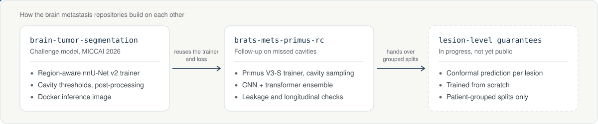

I keep the code for my medical imaging research here. The results and the reasoning behind each project are on my [portfolio](https://sshemanth.github.io/my-portfolio/). This page is for finding the code, running it and reusing parts of it.

## Repositories

| Repository | What is inside | Runs with |
|---|---|---|
| [brain-tumor-segmentation](https://github.com/sshemanth/brain-tumor-segmentation) | Region-aware nnU-Net v2 trainer for BraTS-METS 2026, cavity threshold tuning, post-processing and the Docker image used for the challenge. Code for the [MICCAI 2026 paper](https://papers.miccai.org/miccai-2026-sat/BraTS_METS_008.html) | nnU-Net v2, Conda, Docker |
| [brats-mets-primus-rc](https://github.com/sshemanth/brats-mets-primus-rc) | Primus V3-S trainer with cavity-focused sampling, CNN and transformer ensemble inference, bootstrap comparisons, patient leakage and longitudinal checks | nnU-Net v2 from GitHub, Docker |
| [knee-mri-weak-supervision](https://github.com/sshemanth/knee-mri-weak-supervision) | Three radiology report labellers, label fusion, a DICOM slice cache and 2.5D ConvNeXt training for the RSNA 2026 knee challenge | Kaggle notebooks, Ollama for the local Qwen labeller |
| [multimodal-lesion-diagnosis](https://github.com/sshemanth/multimodal-lesion-diagnosis) | Dual-image and metadata fusion package for MILK10k, YAML configs, rare-class oversampling and out-of-fold ensemble weight search | Google Cloud GPU or AWS SageMaker, Weights & Biases, Docker |
| [trust-admet](https://github.com/sshemanth/trust-admet) | Six molecular property model families with calibration, applicability domain, conformal and uncertainty modules, served as a CLI, FastAPI service and Gradio app. [Archived on Zenodo](https://doi.org/10.5281/zenodo.20997792) | pip, Docker |

<picture>
  <source media="(prefers-color-scheme: dark)" srcset="assets/repo-map-dark.svg" />
  
</picture>

## Parts you can reuse

These come from repositories with an open licence.

- An nnU-Net v2 trainer with the region-aware Tversky and BCE loss: [`nnUNetTrainerCoreCavityV3ResEncL.py`](https://github.com/sshemanth/brats-mets-primus-rc/blob/main/nnunet_trainers/nnUNetTrainerCoreCavityV3ResEncL.py)
- A Primus V3-S trainer that samples resection cavity patches more often: [`nnUNetTrainerPrimusV3S_RegionAwareRC.py`](https://github.com/sshemanth/brats-mets-primus-rc/blob/main/nnunet_trainers/nnUNetTrainerPrimusV3S_RegionAwareRC.py)
- Five-fold BraTS-METS 2026 splits grouped by patient, so no patient is in both training and validation: [`splits_final_grouped.json`](https://github.com/sshemanth/brats-mets-primus-rc/blob/main/results/fold0/splits_final_grouped.json)
- A rule-based labeller for knee MRI reports in six languages, with a negation check: [`regex_labeler.py`](https://github.com/sshemanth/knee-mri-weak-supervision/blob/main/labelling/regex_labeler.py)
- Applicability domain, conformal prediction and uncertainty modules for molecular models: [`trust_admet/trust`](https://github.com/sshemanth/trust-admet/tree/main/src/trust_admet/trust)

## Not public yet

- Lesion-level conformal guarantees for post-treatment brain metastasis segmentation, the next step after brats-mets-primus-rc.
- Atrial fibrillation detection from 12-lead ECGs, trained on PTB-XL and tested on Chapman-Shaoxing and Georgia, with attribution and counterfactual tests. It runs on Apple Silicon or CUDA.

Questions about the code, or a bug: open an issue in the repository. Anything else: [sshemanthofficial@gmail.com](mailto:sshemanthofficial@gmail.com) or [LinkedIn](https://www.linkedin.com/in/sshemanth/).
